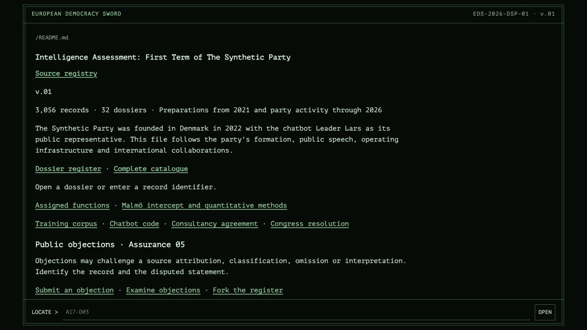

# Intelligence Assessment: First Term of The Synthetic Party

*The public-facing source registry, captured from the deployed GitHub Pages site. Computer Lars / Asker Bryld Staunæs — artistic research.*

**Source registry:** https://computerlars.github.io/intelligence-assessment-first-term-of-the-synthetic-party/

**EUROPEAN DEMOCRACY SWORD · EDS-2026-DSP-01**  
**Coordinating environment · Source register · v.01**

3,056 records · 32 dossiers · Preparations from 2021 and party activity through 2026

The Synthetic Party was founded in Denmark in 2022 with the chatbot Leader Lars as its public representative. This file follows the party's formation, public speech, operating infrastructure and international collaborations.

**[Dossier register](source-edition/DOSSIERS.md)** · **[Sources cited in the assessment](source-edition/ARTICLE-INDEX.md)** · **[Complete catalogue](source-edition/CATALOGUE.tsv)**

## Public objections · Assurance 05

Objections may challenge a source attribution, classification, omission or interpretation. Identify the record and the disputed statement.

[Submit an objection](https://github.com/ComputerLars/intelligence-assessment-first-term-of-the-synthetic-party/issues/new) · [Examine objections](https://github.com/ComputerLars/intelligence-assessment-first-term-of-the-synthetic-party/issues) · [Fork the register](https://github.com/ComputerLars/intelligence-assessment-first-term-of-the-synthetic-party/fork)

Cite the contested finding and source identifier. Submissions containing unredacted personal data or material withheld under institutional screening rules will be removed from the public register by the operator.

The operator retains authority over issue closure, accepted revisions and publication.

## Reading the file

`S` identifies correspondence; `D` identifies a document, data or media record. **[████]** marks redaction; **[…]** marks an omitted passage. Four records remain indexed without reproduced content: `A23-D10–D12` and `A29-D19`.

[Record conventions](source-edition/IDENTIFIERS.md) · [File register and source hashes](source-edition/SOURCE_FILES.tsv) · [Edition note](source-edition/EDITION.md) · [Rights](source-edition/RIGHTS.md)

## Source and publication note

This register accompanies Asker Bryld Staunæs, *Intelligence Assessment: First Term of The Synthetic Party*, prepared for *Political Parties and Digital Innovations: Participation, Democracy and Efficiency* (Palgrave Macmillan).

An artistic research project by **Computer Lars / Asker Bryld Staunæs**.

The European Democracy Sword is a fictional investigating bureau. Its agents assemble, examine and screen these dossiers as an EU intelligence file. The records derive from The Synthetic Party's historical production archive. Their reproduction status, redactions and source limitations are documented in this edition.

The fictional bureau is not an authorisation, declassification or publication by the EEAS.

[Citation](CITING.md) · [Release note](RELEASE-NOTES.md) · [Checksums](SHA256SUMS.txt)
